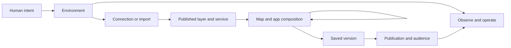

# Use the Honua GIS workflow language

Honua's intended agent experience has three journeys: **set up Honua with AI;
add services and layers and operate Honua with AI; make and refine maps in
realtime with AI.** The workflow language gives agents shared meanings for
those requests. People describe what they want; agents resolve the objects,
choose supported tools, and verify the result.

For example: “Connect our shelter database, expose the shelters to the team,
and put them on a map. Make the flood zones less prominent.” The agent must
distinguish registering the database, publishing a data layer, setting access,
and changing the appearance of a drawing layer. They have different effects.

## One language, two goals

**Help people ask for GIS outcomes clearly.** Learn which objects and decisions
matter, without learning tool names or writing YAML. Start with a short request;
add meaningful constraints as needed. The agent should infer from established
context and ask a focused question only when a consequential choice is missing.

**Help agents carry out that meaning across tasks.** Bind those objects and
constraints to installed interfaces, carry returned identities into the next
task, observe the outcome, and preserve enough durable state to resume. A
successful explanation or valid workflow document is not execution.

Both views come from the same OKF pages. The human guide, agent context graph,
and tool-binding references must use the same definitions.

## The complete journey



The arrows carry concrete results: the environment endpoint and identity, the
connection or imported dataset, the published layer and service, then the
composition, saved version, and publication. Operations continue throughout the
journey. The Studio loop is ask, see, refine, and undo; Git is optional.

For a hands-on walkthrough, use [Get started with AI](../../get-started/with-ai.md).

## Learn the distinctions that improve a prompt

| Intended work | Useful meaning to express | Natural prompt |
| --- | --- | --- |
| Install | Target and evaluation outcome | “Set up Honua locally in Docker and prove it works with sample data.” |
| Connect | Existing source, credential reference, copying choice | “Connect our PostGIS database using this secret reference and serve parcels without copying them.” |
| Import | Source, new destination, provenance | “Import this GeoPackage into a new dataset; keep the original unchanged and report any omitted content.” |
| Publish data | Layer/service and audience | “Expose those parcels in the planning service for our team.” |
| Analyze | Subject, condition, units, result | “Show shelters within 500 meters of these flood zones; keep the result as a separate analysis layer.” |
| Compose | Selected drawing, appearance, interaction | “Add those shelters to this map, style them by capacity, and put a table beside it.” |
| Save | Durable content checkpoint | “Save this version so I can reopen it tomorrow.” |
| Publish a map/app | Saved composition, destination, audience | “Publish this saved app back to Honua for the planning team.” |
| Operate | Environment, intended change, recovery expectation | “Update this deployment to the selected release, check compatibility, and verify its available recovery protection.” |
| Resume | Prior outcome and next task | “Reopen the app we saved and continue styling; reuse the layers already published.” |

This is a vocabulary for expressing intent, not a form to fill out on every
turn. “Hide that layer” is enough when the selected drawing is known. The agent
can discover Docker installation and source schema; the person supplies choices
such as intended audience or which of two equally plausible datasets to use.
A prompt need not contain every spatial parameter, but the agent must resolve
parameters that materially change its result before execution.

## 1. Choose the right kind of workflow

| Journey | Agent work | What establishes completion |
| --- | --- | --- |
| Set up Honua | Use the authorized host's deployment tools and a documented install path; connect MCP after the server starts. | The intended artifact is running, authentication works, and the required state and capabilities are available. |
| Add services and layers | Register or inspect a connection, publish the intended data, attach it to the requested service, and check access. | A client using the intended identity can discover and query the right data through the selected interface. |
| Operate Honua | Read health and findings, choose a supported operation, and follow its returned state. | The intended operational outcome is observed; acceptance or a pending proposal alone is incomplete. |
| Make maps in realtime | Add or change drawing references, styles, controls, and view state; show the result and refine or undo it. | The current composition and renderer show the requested change, with unrelated content preserved. |

Start with [install and configure](install-configure.md),
[connect and publish data](connect-publish-data.md),
[Operating Honua](../operate/README.md), or
[realtime Studio design](design-studio.md).
Use the [package quickstart](../../get-started/quickstart.md) for an isolated
local installation. An uninstalled server cannot supply its own MCP tools:
bootstrap uses the host's tools; server discovery follows startup. A published
layer is needed for a data query, not for connecting an agent to an empty server.

## 2. Distinguish the three languages

| Representation | Purpose | Execution boundary |
| --- | --- | --- |
| `honua.gis-workflow/v1` in OKF Markdown | Describe intent, typed objects, effects, checks, and recovery. | Descriptive metadata; its validator does not dispatch tools. |
| [Honua Spec grammar](../../developer/spec-grammar/spec-grammar-v1.0.md) | Represent declarative sources, scopes, compute, maps, and outputs in canonical JSON or its text projection. | Use its parser, schema, and supported runtime bindings. Grammar acceptance alone is insufficient. |
| [Workflow packages](../query-analyze/automate-workflows.md) | Wire process nodes and data edges for job orchestration. | Use the package lifecycle and installed scheduler/worker contracts. |

The GIS DSL in this guide is the first row. Its container is OKF v0.2:
Markdown plus YAML frontmatter, with a concept ID derived from the path inside
the `docs/` bundle. Honua supplies the `workflow` producer profile. Do not send
that YAML to the Spec parser or a workflow-package endpoint.

## 3. Resolve meaning from the conversation

Use the selected object, current map, caller, environment, and parameters
already supplied. [Everyday GIS requests](../../concepts/domain/intent-interpretation.md)
explains how to interpret phrases without requiring a prompt grammar.

- “Add this layer” in a map usually adds a drawing reference to existing data.
- “Publish this table” exposes a data resource through a service.
- “Hide flood zones” changes drawing visibility; it does not delete a layer.
- “Save this” checkpoints composition; it does not grant an audience access.
- “Make this public” requires an explicit artifact and audience, including its
  data dependencies.

Ask only when remaining interpretations materially change the outcome. An
already selected layer does not need to be selected again. A known audience
does not need repeated confirmation. Spatial analysis still needs the actual
distance, units, CRS, predicate, and null semantics when they affect the result.

## 4. Read a typed workflow

The following is a complete example of **documentation frontmatter**, not a
tool-call payload. It describes hiding the selected drawing layer in an
existing map. The action's `verb` is a semantic label, not an MCP tool name.

```yaml
type: guide
title: Hide a selected drawing layer
workflow:
  profile: honua.gis-workflow/v1
  intent: Hide the selected drawing layer in the current map.
  inputs:
    - name: map
      concept: /concepts/domain/map.md
      required: true
      description: Current draft identity, generation, and composition.
    - name: drawing
      concept: /concepts/domain/map-layer.md
      required: true
      description: Selected drawing reference within that map.
  outputs:
    - name: map
      from: $actions.hide.map
      concept: /concepts/domain/map.md
  constraints:
    - Preserve source records, published resources, and unrelated drawing state.
  ambiguities: []
  actions:
    - id: hide
      verb: hide_drawing_layer
      inputs:
        - name: map
          from: $inputs.map
          concept: /concepts/domain/map.md
        - name: drawing
          from: $inputs.drawing
          concept: /concepts/domain/map-layer.md
      outputs:
        - name: map
          concept: /concepts/domain/map.md
      interfaces:
        - kind: mcp
          operation: honua_studio_set_layer_visibility
          contract: /studio/mcp-tools.md
      effect: update
      effectTarget: map_content
      preconditions:
        - The selected drawing belongs to this map and its generation is current.
        - The installed operation supports changing visibility for this draft.
      authorization:
        - The caller may edit this draft under the deployment's effective policy.
      idempotency: Read back an uncertain result before repeating the mutation.
      checks:
        - The returned draft marks only the selected drawing as hidden.
        - The current renderer reflects that visibility at the accepted revision.
      recovery:
        - Reconcile a generation conflict while preserving unrelated edits.
      rollback:
        snapshot: Record prior visibility and the draft generation.
        revisionGuard: Re-read the draft and preserve subsequent edits.
        scope: Only the selected drawing's visibility in this map.
        compensation: Restore prior visibility through the supported draft mutation.
        verification:
          - Read back visibility and inspect the corresponding current preview.
        nonReversible: []
```

The `from` references connect named slots. `$inputs.map` selects a workflow
input; `$actions.hide.map` selects an action output. Types are exact concept
identities: a published layer cannot fill a slot typed as a drawing layer.
Bindings determine dependency order. The profile has no executable `if`,
retry loop, or automatic approval step; runtime-dependent branches must be
resolved using the selected operation's actual result.

For field requirements and supported effects, see the
[language contract](../../concepts/domain/workflow-language.md#workflow-contract).

## 5. Bind the intent to the installed interface

Connect through the [MCP guide](../connect/ai-agents-mcp.md), inspect the current
capabilities and `tools/list` schemas, and use the supported SDK or MCP call.
The workflow's interface links are candidates, not proof of runtime support
or a mandatory call sequence. Bind the real draft and drawing IDs, generation,
and requested visibility using that schema. Do not invent identifiers or infer
them from display names.

Routine Studio composition should remain direct and responsive. A deployment
can currently impose a different guardrail; the
[Studio policy boundary](../../studio/mcp-tools.md#composition-policy)
describes this implementation limit. Report an unexpected policy outcome as
such, rather than adding a review queue to every design turn or changing policy
to force the operation through.

When publication is requested, the current server distinguishes an authorized
admin's direct publication from another caller's pending proposal. Inspect the
returned status and identities; a tool named `propose` can still complete a
publication for an admin. The [publication workflow](publish-share-map.md)
describes both outcomes. Protected operational proposal tools retain their own
separate decision contract. Do not generalize one tool's policy to all AI work.

## 6. Verify the promised result

Keep four observations distinct:

1. **Document consistency:** the named slots, types, effects, dependencies,
   and recovery fields validate.
2. **Interface compatibility:** the installed operation accepts the intended
   request and the caller can use it.
3. **Runtime outcome:** returned resource, generation, job, or publication
   state confirms the requested operation completed.
4. **User outcome:** the visible map, query result, or operational health
   satisfies the original request.

`honua_studio_preview_draft` returns a preview plan. It is not evidence that
the browser rendered the correct result. Local preview is not a saved version;
job acceptance is not terminal success; a pending proposal is not publication.
After an interrupted write, inspect the returned durable identity before retrying.

For analysis, verify the selected records, spatial meaning, and output lineage,
not just a row count. AI workflows preserve authoritative feature attributes
and geometry. Report source-data problems through findings and recommendations.

## 7. Carry the workflow across tasks and sessions

A task may finish before the overall goal does. Installation produces a verified
environment that the data task consumes; publication produces resource identities
that map composition consumes. Carry those observed outputs forward instead of
asking the person to reconstruct the context or repeating completed work.

The [session and handoff contract](../../concepts/domain/session.md) should retain:

| Handoff information | Purpose |
| --- | --- |
| Goal, accepted choices, constraints, next unresolved task | Preserve user intent and avoid unnecessary clarification. |
| Environment endpoint, tenant/actor context, artifact revision | Reconnect to the correct target and reauthenticate. |
| Connection, dataset, service and layer identities | Reuse actual resources rather than names or invented IDs. |
| Draft/item identity, current generation, saved version and hash | Resume the right composition while detecting intervening edits. |
| Job, operation and proposal identities with observed states | Reconcile uncertain or pending work before retrying. |
| Verification observations, limitations and recovery scope | Distinguish completed work from claims and incomplete steps. |
| Secret references and source links, never secret values | Recover the appropriate bindings without copying credentials. |

On resume, read current state and permissions, check for drift, then continue
from the next unmet outcome. A handoff is context, not a grant of authority.
Do not report a pending job as finished or automatically resubmit it because a
conversation ended. A saved version can outlive a chat; unpersisted conversation
memory cannot provide that guarantee.

This is an agent coordination contract built on existing resource state. It does
not claim that the OKF profile supplies a durable cross-task execution engine.

## 8. Maintain the human and agent views together

Edit the Markdown concepts and workflow pages. Update `docs/SUMMARY.md` for a
new guide, then regenerate the agent views from those sources:

```bash
python3 scripts/ci/generate-okf-graph.py
python3 scripts/ci/generate-llms-txt.py
python3 scripts/ci/check-okf-bundle.py --summary
python3 scripts/ci/generate-okf-graph.py --check
python3 scripts/ci/generate-llms-txt.py --check
python3 scripts/ci/check-doc-links.py
```

These are repository documentation-maintenance commands, not GIS execution
commands. Install the YAML dependency as described in the
[OKF bundle guide](../../okf/README.md#agent-graph-and-context).
Static graph validation deliberately reports `executionVerified: false`.
Pin the source revision and bundle digest when recording an agent run; changing
a README without refreshing the generated graph leaves another agent view stale.

Continue with the [workflow catalog](README.md) for full examples, and
[semantic verification](../../concepts/domain/semantic-contracts.md) for the
distinction between today's document checks and proposed runtime predicates.
